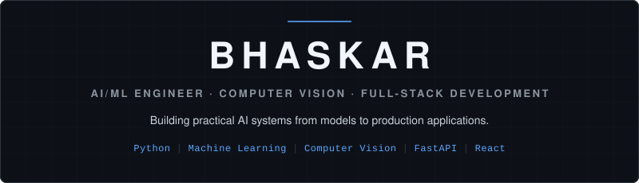
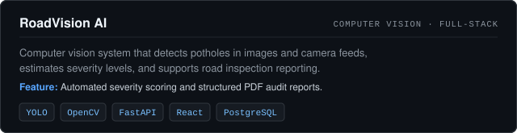
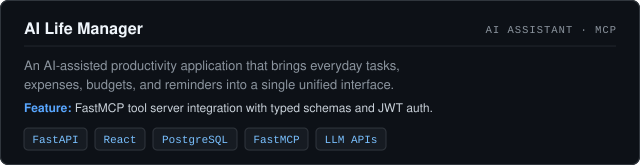
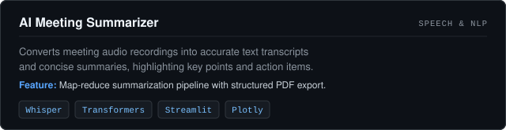
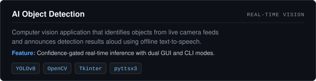
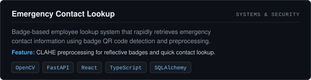
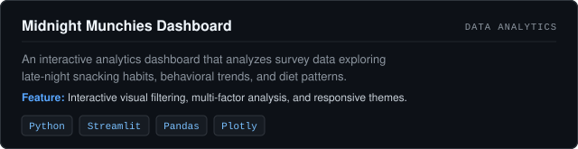

  

Live Deployments: <a href="https://ai-life-manager-two.vercel.app">AI Life Manager</a> · <a href="https://roadvision-ai.up.railway.app">RoadVision AI</a> · <a href="https://midnight-munchies-dashboard-bhaskar.streamlit.app/">Midnight Munchies</a>

 

## About

I'm an Information Science and Engineering student focused on building practical AI-powered and full-stack applications. My work spans computer vision, machine learning, speech and language applications, and backend engineering. I enjoy taking projects from initial experimentation through implementation, deployment, and documentation.

---

## Featured Projects

  
   
  <a href="https://github.com/bhaskibhaskar007/RoadVision-AI">Repository</a> &nbsp;·&nbsp; <a href="https://roadvision-ai.up.railway.app">Live Demo</a>

  
   
  <a href="https://github.com/bhaskibhaskar007/ai-life-manager">Repository</a> &nbsp;·&nbsp; <a href="https://ai-life-manager-two.vercel.app">Live Demo</a>

  
   
  <a href="https://github.com/bhaskibhaskar007/AI-meeting-summarizer">Repository</a>

  
   
  <a href="https://github.com/bhaskibhaskar007/AI-Object-Detection">Repository</a>

  
   
  <a href="https://github.com/bhaskibhaskar007/QR-Emergency-System">Repository</a>

  
   
  <a href="https://github.com/bhaskibhaskar007/midnight-munchies-dashboard">Repository</a> &nbsp;·&nbsp; <a href="https://midnight-munchies-dashboard-bhaskar.streamlit.app/">Live Demo</a>

---

## Technical Skills

| Domain | Technologies |
| :--- | :--- |
| **Programming** | `Python` · `TypeScript` · `JavaScript` · `SQL` |
| **AI & Computer Vision** | `Machine Learning` · `YOLO` · `OpenCV` · `Whisper` · `Transformers` |
| **Backend** | `FastAPI` · `REST APIs` · `SQLAlchemy` · `Pydantic` |
| **Frontend** | `React` · `Streamlit` · `Tailwind CSS` · `Vite` |
| **Data & Tools** | `Pandas` · `Plotly` · `Git` · `GitHub` · `Docker` · `PostgreSQL` |

---

## GitHub Activity

  
  

### GitHub Contribution Snake

  <picture>
    <source media="(prefers-color-scheme: dark)" srcset="https://raw.githubusercontent.com/bhaskibhaskar007/bhaskibhaskar007/dist/github-contribution-grid-snake-dark.svg">
    <source media="(prefers-color-scheme: light)" srcset="https://raw.githubusercontent.com/bhaskibhaskar007/bhaskibhaskar007/dist/github-contribution-grid-snake.svg">
    
  </picture>

---

## Connect

  
  <!-- Placeholder links: Add and uncomment when ready
  
  
  -->

  Building practical AI systems from models to production applications.

